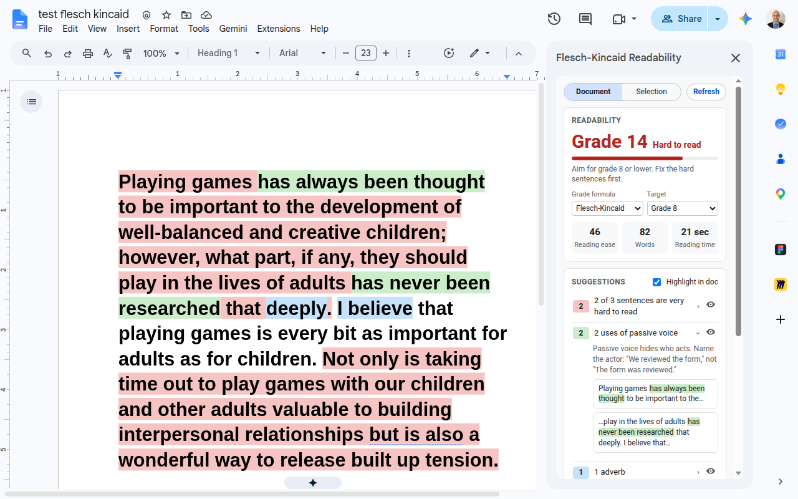

# Google Docs Flesch-Kincaid Readability Calculator

A Google Docs add-on that shows your readability grade and Hemingway-style plain language suggestions in a sidebar, highlights issues in the document, and fixes them in one click.



---

## Features

Everything the Hemingway Editor checks, inside Google Docs, plus more:

- **Readability grade** with a target you choose (grade 4–14) and a Good / OK / Hard rating. Pick the headline formula: Flesch-Kincaid (default), Hemingway-style ARI, or the average of five formulas.
- **All the major scores:** Flesch-Kincaid grade, Flesch reading ease, Automated Readability Index (the formula Hemingway uses), Gunning Fog, SMOG, Coleman-Liau, and their average.
- **Hemingway-style suggestions:**
  - Hard and very hard sentences (red and yellow)
  - Words with simpler alternatives (purple), from the federal plain language word list
  - Adverbs, passive voice, and qualifiers like "very", "just", and "I think"
- **Extra plain language checks Hemingway does not do:** wordy phrases ("in order to" → "to", "due to the fact that" → "because"), repeated words ("the the"), and long paragraphs.
- **Maryland Plain Language Standards checks:** acronyms used before they are spelled out, "shall" → "must", "the applicant" → "you", and long lists inside a sentence that should be bullets.
- **AI rewrites (Gemini 3.5 Flash-Lite):** click **✨ Rewrite** on a hard sentence, a passive sentence, or a long list, or select any text and choose **Rewrite selection**. Each rewrite is:
  - re-scored, and retried once if it is still above your target grade
  - checked by a second AI pass that lists any fact, number, date, or requirement that was added, dropped, or changed
  - only applied when you click **Accept**
- **Ignore:** dismiss a suggestion you disagree with. Ignored items are remembered for that document and can be brought back.
- **Grade by section:** a grade for each heading, so you can see which part of a long document needs work. Click a section to jump to it.
- **Copy summary:** copy the scores and suggestion counts to paste into an email or review comment.
- **Works in the document:**
  - **Highlight in doc** colors issues right in the Google Doc. Each category can be shown or hidden. Highlights only use the add-on's own colors, so your highlights stay. Clear them from the sidebar or **Extensions → Flesch-Kincaid Readability → Clear Highlights**.
  - Click any suggestion to select that text in the document.
  - One-click fixes replace a word or delete a hedge. Deleting cleans up the extra space or comma and capitalizes the sentence again.
  - **Selection** mode checks only the text you select.
  - **Update as I type** re-checks the document a few seconds after it changes.
- **Statistics:** words, sentences, paragraphs, characters, syllables, averages, passive sentence percentage, and reading and speaking time.

### Compared with Hemingway

These sample texts give the same grade, word count, sentence count, and hard and very hard sentence counts in both tools (see `tests/`):

| Text | Hemingway | This add-on (ARI) |
| --- | --- | --- |
| Hemingway's own sample (`hemingway-sample.txt`) | Grade 8, 180 words, 13 sentences, 1 very hard, 1 hard | 7.7 → 8, 180, 13, 1, 1 |
| Benefits memo (`test-memo.txt`) | Grade 10, 156 words, 11 sentences, 3 very hard, 1 hard | 10.4 → 10, 156, 11, 3, 1 |
| Games paragraph (`games.txt`) | Grade 15, 82 words, 3 sentences, 2 very hard | 15.0 → 15, 82, 3, 2 |

On the memo, the add-on also flags "cognizant", "disseminate", "utilizes", "approximately", "the majority of", and "the the". Hemingway's free editor misses all of these.

---

## Technical Architecture

The project is a Google Apps Script editor add-on. Text analysis is pure JavaScript with no Apps Script calls, so it also runs in Node for tests.

- **`src/TextAnalyzer.js`**: sentence splitting (handles abbreviations, initials, and decimals), syllable counting, readability formulas, and style checks. `analyzeParagraphs()` returns totals, scores, and a list of issues with paragraph offsets.
- **`src/Code.js`**: menus and sidebar. It reads paragraphs (including tables and lists), analyzes the document or the selection, writes and clears highlights, selects issues, and applies fixes. Paragraphs are identified by their path of child indexes. Fixes check that the text is still there before changing it.
- **`src/Sidebar.html`**: the sidebar UI. It calls the server with `google.script.run`. When "Update as I type" is on, it compares a cheap document fingerprint every 4 seconds and re-analyzes only when the text or selection changes.

Settings (target grade, formula, highlight and auto-update choices) are saved per user with `PropertiesService`. Ignored suggestions are saved per document.

AI rewrites call the Gemini API from `aiRewrite()` in `Code.js` with `UrlFetchApp`. The API key is read from the **`GEMINI_API_KEY` script property** (Apps Script → Project Settings → Script properties). It is never sent to the sidebar or stored in the repo. Each user gets up to 300 rewrites a day. The model name is the `GEMINI_MODEL` constant.

---

## How It Works & Calculations

- **Words** are runs of letters and numbers. Contractions and hyphenated words count as one word.
- **Sentences** end at `.`, `!`, `?`, or the end of a paragraph, so headings and list items without periods count as sentences. Abbreviations such as "Dr.", "Jan.", "U.S.", and "e.g." do not end a sentence.
- **Syllables** use vowel-group rules with fixes for silent endings, plus an exception list. They match the CMU Pronouncing Dictionary for 97% of the 5,000 most common English words. The earlier counter matched 90%.

| Score | Formula |
| --- | --- |
| Flesch-Kincaid grade | 0.39 × (words / sentences) + 11.8 × (syllables / words) − 15.59 |
| Flesch reading ease | 206.835 − 1.015 × (words / sentences) − 84.6 × (syllables / words) |
| ARI (Hemingway-style) | 4.71 × (letters / words) + 0.5 × (words / sentences) − 21.43 |
| Gunning Fog | 0.4 × (words / sentences + 100 × complex words / words) |
| SMOG | 1.043 × √(polysyllables × 30 / sentences) + 3.1291 |
| Coleman-Liau | 0.0588 × letters per 100 words − 0.296 × sentences per 100 words − 15.8 |

**Hard sentences** follow Hemingway: a sentence of 14 or more words is *hard* when its own ARI grade rounds to 10–13 and *very hard* at 14 or more. Headings are skipped.

Reading ease guide: 90–100 very easy, 80–90 easy, 70–80 fairly easy, 60–70 plain English, 50–60 fairly hard, 30–50 hard, 0–30 very hard.

---

## Repository Structure

```
├── .clasp.json          # Clasp configuration containing the script ID
├── tsconfig.json        # TypeScript configuration for Apps Script compilation
├── src/
│   ├── Code.js          # Google Apps Script lifecycle hooks & RPC wrappers
│   ├── TextAnalyzer.js  # Text parsing, syllable counts, & readability logic
│   ├── Sidebar.html     # User interface (HTML, CSS styling, client-side JS)
│   └── appsscript.json  # Add-on configuration manifest (scopes, runtime)
└── tests/
    ├── analyzer.test.js # Node tests for TextAnalyzer.js
    └── *.txt            # Sample texts compared against Hemingway
```

Run the tests with Node 18 or later:

```bash
node --test tests/analyzer.test.js
```

---

## Local Development & Deployment

This project uses `clasp` (Command Line Apps Script Projects) to synchronize local files with the Google Apps Script ecosystem.

### Prerequisites

Install `clasp` globally:
```bash
npm install -g @google/clasp
```

Log in to your Google Account:
```bash
clasp login
```

### Initializing the Project

To clone the existing script project linked to this repository:
```bash
clasp clone <scriptId>
```
*(The `scriptId` can be found in `.clasp.json`).*

Or, to initialize a brand new Google Doc container script:
```bash
clasp create --title "Google Docs Flesch-Kincaid" --type docs
```

### Development Workflow

- **Pull changes from the Apps Script editor:**
  ```bash
  clasp pull
  ```
- **Push local changes to the Apps Script editor:**
  ```bash
  clasp push
  ```
- **Automatically watch and push changes during development:**
  ```bash
  clasp push --watch
  ```
- **Open the project in the online Apps Script editor:**
  ```bash
  clasp open
  ```

---

## Permissions & OAuth Scopes

The add-on declares the following scopes in `src/appsscript.json`:

- `https://www.googleapis.com/auth/documents.currentonly`: Grants access to read and edit the document the user is currently working on. Used to analyze the text, and to add highlights or apply fixes when you ask.
- `https://www.googleapis.com/auth/script.container.ui`: Allows the script to create and show the sidebar user interface within Google Docs.
- `https://www.googleapis.com/auth/script.external_request`: Lets the add-on call the Gemini API for AI rewrites. Requests can only go to `generativelanguage.googleapis.com`, plus `oauth2.googleapis.com` and `bigquery.googleapis.com` for usage logging (see `urlFetchWhitelist` in the manifest).
- `https://www.googleapis.com/auth/userinfo.email`: Lets the add-on read your email address, so AI rewrite usage logs show who made each request.

---

## Installing & Usage

The add-on is published privately to the maryland.gov domain on the Google Workspace Marketplace. In any Google Doc, open **Extensions → Add-ons → Get add-ons**, search for "Flesch-Kincaid Readability", and click **Install**. Then open **Extensions → Flesch-Kincaid Readability → Show Sidebar**. The sidebar updates as you type. Turn on **Highlight in doc** to see issues in the document.

---

## Privacy

The add-on can only open the document you have open (see the scopes above).

- **Reading:** it reads the document text only while the sidebar is open. Readability scores and suggestions are worked out inside Google Apps Script.
- **Changes:** it changes your document only when you turn on highlights, click a fix, or accept an AI rewrite.
- **AI rewrites:** when you click **✨ Rewrite** or **Rewrite selection**, the add-on sends only that sentence or selection to Google's Gemini API to write a plain language version and check its meaning. Nothing is sent unless you click. The add-on uses the paid Gemini API, and Google does not use paid API data to train its models.
- **Usage logs:** each AI rewrite is logged to a BigQuery table run by Maryland DoIT. The log holds your email address, the time, the sentence you sent, the rewrite, whether you accepted it, and its token count and cost. We use it to track usage and cost. Nothing is logged for readability checks or other fixes.
- **Storage:** apart from the rewrite log, the add-on does not store your document text. Your sidebar settings and daily rewrite count are saved to your Google account. Suggestions you ignore are saved with the document.

---

## Support

Report problems or request features via [GitHub Issues](https://github.com/DoIT-Artificial-Intelligence/google-docs-flesch-kincaid/issues).

---

## Usage logging

Each AI rewrite streams a row into BigQuery `adept-figure-493916-r5.docs_addon_usage.rewrite_events`. Accepting a rewrite adds a second `accept` row. The view `docs_addon_usage.rewrites` joins these into one row per rewrite with the columns `user, time, sentence, rewrite, accepted, tokens, cost`. You can open it in Google Sheets with **Data → Data connectors → Connect to BigQuery**. Cost is worked out when the row is logged, from `GEMINI_PRICE_PER_M` in `src/Code.js`. Update that constant if the model or its price changes.

The dataset, table, view, and the `docs-addon-logger` service account are managed in Terraform under `infra/`. The service account can only write to this dataset. Its JSON key is not in Terraform, so the private key never lands in state. The key goes in the Apps Script **script property** `BQ_SERVICE_ACCOUNT_KEY`. If the property is missing or logging fails, rewrites still work, and the error goes to the Apps Script log.

```bash
cd infra && terraform init && terraform plan   # state is local (gitignored)
```

---

## Releasing to the Marketplace

The Marketplace listing lives in GCP project `adept-figure-493916-r5` (Marketplace SDK). To release an update:

```bash
clasp push
clasp create-version "description"
```

Then:

1. In Marketplace SDK → **App Configuration**, set **Docs add-on script version** to the new version. If the manifest's `oauthScopes` changed, add the same scopes to the OAuth Scopes list. Click **Save Draft**.
2. Open the **Store Listing** tab and click **Publish**. Saving only creates a draft; users keep the old version until you publish.

Test changes first with Apps Script → **Deploy → Test deployments**, which runs the latest pushed code (HEAD) in a test document.

Store listing text and images are in `store-assets/`. The icons and banner come from `uv run store-assets/make_assets.py`. `screenshot-1280x800.png` is a browser screenshot of the sidebar at a 1280×800 viewport.